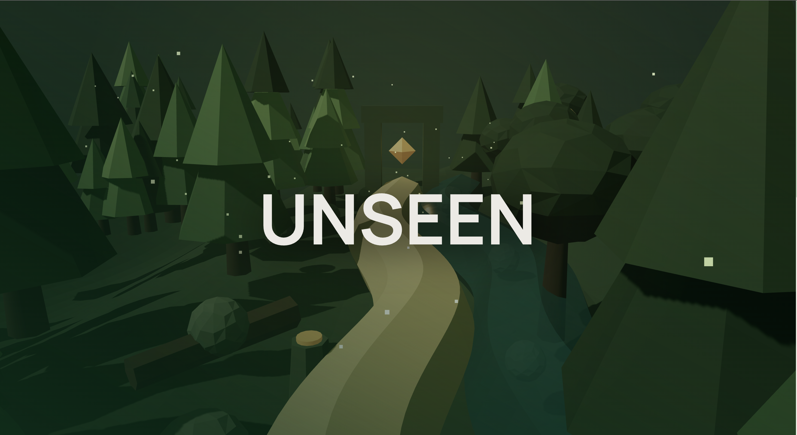
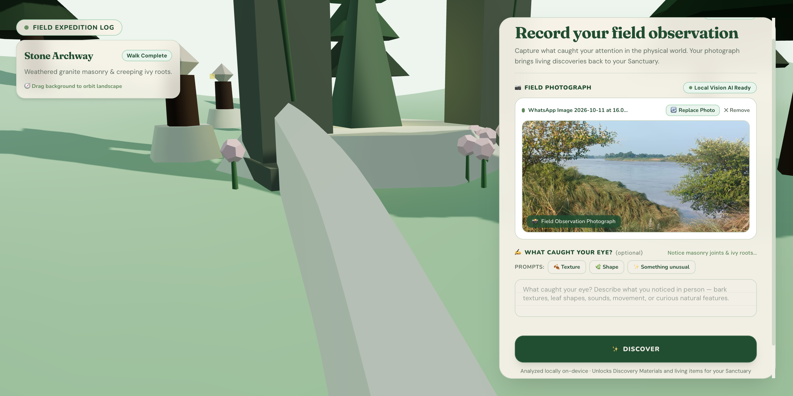
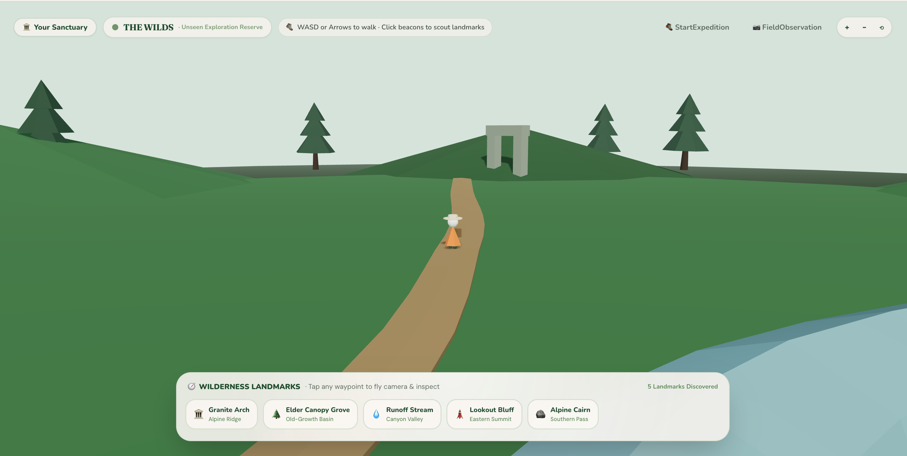
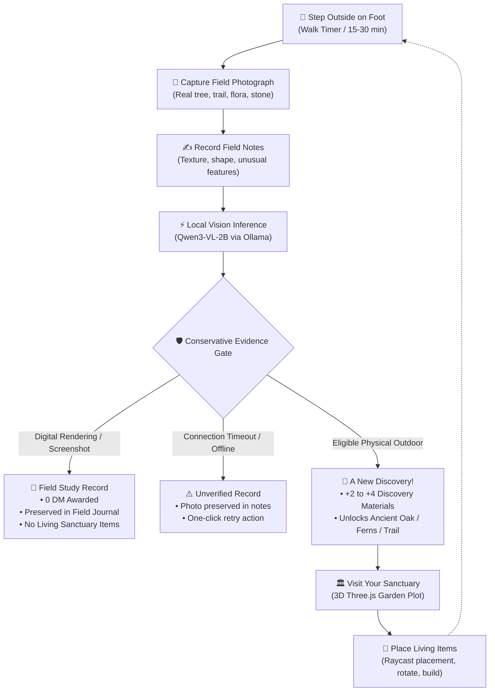
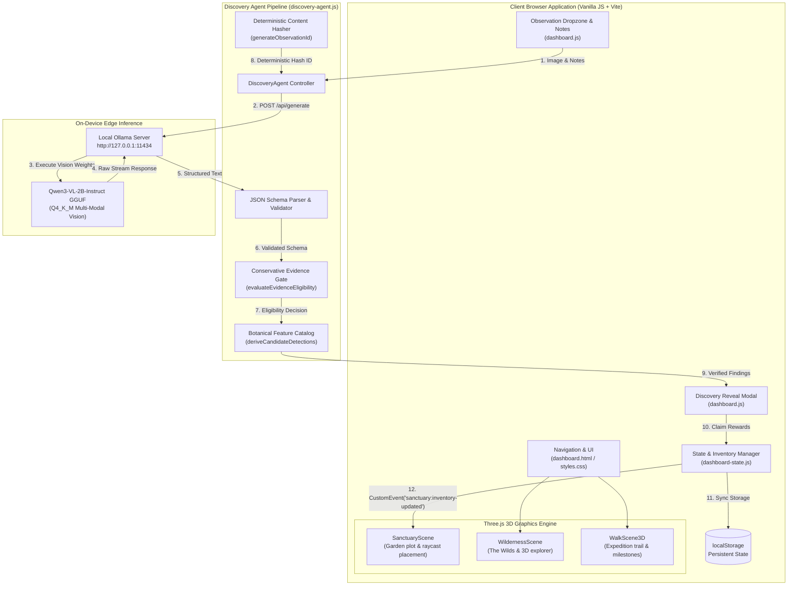

<div align="center">

# UNSEEN

### *A game that only works because reality exists.*

**Go outside. Notice something real. Bring a piece of that discovery back to a world of your own.**

[](https://nodejs.org/)
[](https://threejs.org/)
[](https://vitejs.dev/)
[](https://ollama.com/)
[](https://huggingface.co/Qwen)
[](#11-testing-and-reliability)
[](#8-local-ai-and-open-innovation)

<br />

[**Explore the Code**](https://github.com/urooj-vX/Unseen) • [**Quickstart**](#13-getting-started) • [**Architecture**](#9-architecture) • [**Evidence Gate**](#7-how-the-evidence-gate-works) • [**Test Results**](#11-testing-and-reliability)

<br />



</div>

---

## Table of Contents

1. [The Story — Why UNSEEN Exists](#1-the-story--why-unseen-exists)
2. [Core Philosophy](#2-core-philosophy)
3. [Gameplay Features](#3-gameplay-features)
4. [Screenshots and Gameplay](#4-screenshots-and-gameplay)
5. [The Gameplay Loop](#5-the-gameplay-loop)
6. [How the Evidence Gate Works](#6-how-the-evidence-gate-works)
7. [Local AI and Open Innovation](#7-local-ai-and-open-innovation)
8. [Architecture](#8-architecture)
9. [Engineering Challenges and Solutions](#9-engineering-challenges-and-solutions)
10. [Testing and Reliability](#10-testing-and-reliability)
11. [Technology Stack](#11-technology-stack)
12. [Getting Started](#12-getting-started)
13. [Project Structure](#13-project-structure)
14. [Limitations and Future Roadmap](#14-limitations-and-future-roadmap)
15. [What I Learned](#15-what-i-learned)
16. [Author & Acknowledgments](#16-author--acknowledgments)

---

## 1. The Story — Why UNSEEN Exists

Most digital games are closed loops. They reward you for sitting still, clicking faster, watching screens, and grinding synthetic numbers designed to keep your attention trapped inside an artificial box.

**UNSEEN was built on an opposite conviction:** the most intricate, surprising, and grounding world ever made is the physical environment right outside your front door.

```
       [ Physical Reality ]                     [ Digital Sanctuary ]
    Walk outside on foot           ───►      Cultivate living 3D garden
    Photograph moss, bark, stone   ───►      Earn Discovery Materials
    Notice what caught your eye    ───►      Place Ancient Oaks & Ferns
```

In **UNSEEN**, progression is impossible without physical motion. You put on your shoes, step outside with the Walk Timer, and explore. You look closely at damp riverbanks, ancient oak bark, overgrown granite archways, or lichen creeping across stone. You capture a genuine field photograph and record your field notes. 

Back at your desk, a local open-weight vision model analyzes your photograph on-device. When your observation is verified as authentic physical evidence, you receive **Discovery Materials (DM)** and unlocked living items—Ancient Oaks, Wild Ferns, Beaten Trails, and Stone Cairns—which you place and nurture in your personal 3D Sanctuary.

Your virtual world is not a substitute for physical reality. **It is an artifact of having lived in it.**

---

## 2. Core Philosophy

| Principle | Meaning in Practice |
| :--- | :--- |
| **Reality is the Primary Source** | Virtual rewards cannot be bought or farmed in a menu. They require stepping outside and observing real surroundings. |
| **Local Perception, Not Cloud Telemetry** | Your camera feed and physical surroundings stay on your machine. Vision inference runs locally via Ollama with zero telemetry or API keys. |
| **Model Output ≠ Game Truth** | Vision models hallucinate, hedge, and guess. UNSEEN never treats raw model text as automatic fact; deterministic game logic governs rewards. |
| **Affirmative Evidence Separation** | Models express epistemic doubts in `"uncertainties"`. The Evidence Gate scans affirmative fields only, preventing model hedges from demoting genuine outdoor photos. |
| **Physical Provability Safeguards** | Screenshots, 3D renderings, and digital illustrations are accepted into your Field Journal as study notes, but granted **0 DM** and zero living items. |
| **Honest Engineering Boundaries** | Visual inspection cannot prove GPS coordinates or capture timestamps. We verify visible physical provenance without making ungrounded claims. |

---

## 3. Gameplay Features

### 🥾 1. The Walk Expedition & Timer
Step outside with an integrated expedition timer. Choose your walk duration (10 to 60 minutes) and track estimated steps across undulating 3D waypoints. Completing an expedition awards Walking Points and unlocks observation entry.

### 📷 2. Real-World Field Observation
Upon returning, upload a photograph captured on your walk. A dedicated dropzone accepts mobile camera captures, drag-and-drop images, or sample field baselines.

### ✍️ 3. Field Journal & Prompt Inspiration
Describe what caught your attention in person. Structured prompt chips—**🍂 Texture**, **🌿 Shape**, and **✨ Something unusual**—encourage thoughtful natural history recording rather than passive snapping.

### 🧠 4. On-Device Vision Analysis
Observations are processed locally by `Qwen3-VL-2B-Instruct` running through Ollama. The model extracts visible botanical and geological features, determines scene provenance, and returns strictly validated JSON without sending data to third-party cloud APIs.

### 🛡️ 5. The Conservative Evidence Gate
Before granting rewards, an automated Evidence Gate validates physical authenticity. Digital 3D renders, video game screenshots, and vector graphics are preserved as educational study records with 0 DM, keeping virtual garden items tethered to physical exploration.

### 🌿 6. Discovery Reveal & Reward Ceremony
Verified outdoor discoveries present a rich celebration modal:
- **Concise Title**: Natural descriptive subject naming (e.g., *"Ancient Oak Tree"*, *"Overgrown Stone Archway"*).
- **Noticed in the Field**: Up to three verified visible details chips.
- **Reward Card**: Earned Discovery Materials (+2 to +4 DM) and living items transferred directly to your backpack.
- **Immediate Navigation**: One-click jump to *"Visit My Sanctuary"*.

### 🏛️ 7. Your Living Botanical Sanctuary
An interactive Three.js 3D garden plot where earned rewards become living physical elements:
- **Place Living Items**: Ancient Oaks, Citrus Trees, Wild Ferns, Beaten Trails, Mossy Boulders, and Stone Cairns.
- **Raycast Grid Placement**: Click or drag from your backpack tray directly onto your garden plot.
- **Real-Time Controls**: Rotate, elevate, reposition, or reclaim placed items.
- **Persistent State**: Placed items and material counts persist in `localStorage` across reloads.

### 🌲 8. The Wilds (Exploration Reserve)
Step into an open-world 3D reserve in third-person view. Walk the winding trail using WASD or Arrow keys, scout landmark beacons (Granite Arch, Elder Canopy Grove, Runoff Stream, Lookout Bluff, Alpine Cairn), and fly the camera to inspect terrain waypoints.

---

## 4. Screenshots and Gameplay

### Atmosphere & Landing Experience
The opening 3D landing experience immerses players in an enchanted low-poly pine forest at twilight, inviting them to step off the known path before launching their field expedition.


*Figure 1: The UNSEEN title environment — procedural low-poly forest with animated particle motes and winding exploratory path.*

---

### Field Observation & Local Inference
Upon returning from an outdoor walk, players attach their photograph and record field notes. The interface provides real-time local vision status, writing prompts, and one-click discovery analysis.


*Figure 2: The Observation Interface — 3D specimen expedition log (left) paired with the Natural History Field Journal (right) featuring photo attachment, writing prompts, and local AI readiness indicator.*

---

### The Wilds — Third-Person Exploration Reserve
Players can venture beyond their Sanctuary into The Wilds: a vast Three.js reserve featuring third-person walking controls, interactive landmark beacons, and free-roam camera scouting.


*Figure 3: The Wilds (Unseen Exploration Reserve) — controlling the expeditioner along the trail, scouting distant megalithic archways, and inspecting discovered landmark waypoints.*

---

## 5. The Gameplay Loop



---

## 6. How the Evidence Gate Works

Small vision models are descriptive, not infallible. When asked whether an image is physical or synthetic, small multimodal models frequently output epistemic hedges under `"uncertainties"` (*"the photograph may be a digital rendering or screen capture, but the scene depicts trees outdoors"*).

If an application blindly scans model output for words like *"digital"*, genuine outdoor photographs get falsely rejected. **The Evidence Gate enforces an 8-stage verification pipeline:**

```
[Uploaded Photo] ──► [Ollama Qwen3-VL-2B] ──► [JSON Schema Validation]
                                                     │
        ┌────────────────────────────────────────────┴────────────────────────────────────────────┐
        ▼                                                                                         ▼
[Affirmative Fields]                                                                     [Uncertainties Field]
(evidence_summary, visible_features)                                                     (Lists what photo cannot prove)
        │                                                                                         │
        ▼                                                                                         ▼
Scanned for synthetic markers:                                                           ISOLATED & EXCLUDED
• "3d render", "cgi", "digital rendering",                                                Model epistemic doubts never
• "vector graphic", "video game screenshot"                                               demote genuine outdoor photos!
        │
        ├──────────────────────┬──────────────────────┐
        ▼                      ▼                      ▼
 [Non-Physical / Synth]    [Outdoor Nature]     [Inference Offline]
   Status: Ineligible       Status: Eligible       Status: Unverified
   Rewards: 0 DM            Rewards: +2..4 DM      Rewards: Preserved
   Sanctuary Items: None    Items: Ancient Oak...  Action: Retry
```

### Deterministic Application Guarantees
1. **Separation of Affirmative Evidence from Doubt**: Epistemic hedges in `uncertainties` are strictly quarantined from keyword filters.
2. **Deterministic Observation Identity**: Observation IDs are derived via content hashing of the image buffer (`obs_img_...`). Resubmitting the same image produces the identical ID, preventing duplicate material farming.
3. **Idempotent State Claims**: `DashboardState.claimedObservationIds` prevents duplicate rewards if a player submits the same photo twice.
4. **Baseline Reward Safeguard**: Verified outdoor observations with confirmed physical findings are guaranteed baseline rewards (+2 DM and Wild Ferns) even if botanical item tags match uncommon species.
5. **Clear Error vs Synthetic Separation**: A network failure or inference timeout displays an amber *"Inference Unavailable"* retry banner, never misrepresenting technical issues as fake image rejections.

---

## 7. Local AI and Open Innovation

UNSEEN runs multimodal vision intelligence **entirely on your local hardware** using Ollama and the open-weight `Qwen3-VL-2B-Instruct` model.

### Why Local Open-Weight Models Matter
- **Absolute Privacy**: Walking outdoors and capturing photos involves personal locations and private moments. Cloud vision APIs require uploading your camera rolls to external corporate servers. In UNSEEN, your image buffer never leaves `localhost:11434`.
- **Zero Ongoing Costs**: No API tokens, credits, monthly subscriptions, or rate limits. You can explore and analyze hundreds of photos indefinitely.
- **Offline Autonomy**: Once the model weights are pulled to your device, the discovery pipeline operates in airplane mode on local trails without cellular signal.

### Local Model Configuration
```javascript
export const LOCAL_VISION_MODEL_TAG = 'hf.co/Qwen/Qwen3-VL-2B-Instruct-GGUF:Q4_K_M';
```

- **Runtime**: Ollama (`http://127.0.0.1:11434`)
- **Model**: `Qwen3-VL-2B-Instruct` quantized to `Q4_K_M` (~1.8 GB memory footprint)
- **Prompt Structure**: Strict JSON schema demanding `visible_features`, `scene_type`, `possible_interpretations`, `uncertainties`, and `evidence_summary`.
- **Hardware Performance**: Median latency of **15–22 seconds** on Apple Silicon M-series (16 GB unified memory).

---

## 8. Architecture



---

## 9. Engineering Challenges and Solutions

### 1. The "Uncertainty Leakage" False-Positive Bug
- **The Issue**: Players testing genuine outdoor trees received the *"Field Study Record / 0 DM"* popup.
- **Root Cause**: `Qwen3-VL-2B` returned valid JSON with an `"uncertainties"` key stating: *"the photograph may be a digital rendering or screen capture, but the scene is clearly outdoors"*. The eligibility gate concatenated `uncertainties` into `allModelText` and scanned for phrases like `'may be a digital'`, demoting genuine photos to `status: 'uncertain'` and stripping rewards.
- **The Fix**: Quarantined the `"uncertainties"` key. Synthetic keyword evaluation now checks **only** affirmative evidence fields (`evidence_summary`, `visible_features`).

### 2. Sample Photo Night-Scene Misclassification
- **The Issue**: Clicking the developer drawer's sample photo button continually produced 0 DM.
- **Root Cause**: The button loaded `p01_a.jpeg` (a street sign photographed against pitch darkness). The vision model classified the pitch-black backdrop as `scene_type: 'indoor'`.
- **The Fix**: Updated the sample photo to `p08_a.jpeg` (a genuine solitary oak tree in an open grassy field), providing an instantly rewarding developer baseline.

### 3. Conflating Network Errors with Synthetic Rejections
- **The Issue**: When local inference timed out or Ollama was offline, the UI showed *"Physical exploration unlocks living items"*, accusing the player of submitting a fake image.
- **Root Cause**: Technical exceptions defaulted `eligibilityStatus` to `'ineligible'`.
- **The Fix**: Decoupled `isError` from `isSynthetic`. Technical timeouts now trigger a dedicated amber *"Inference Unavailable"* card with a direct **Retry Discovery** button, safely preserving the user's uploaded photo and notes.

### 4. Reward Idempotency via Deterministic Image Hashing
- **The Issue**: Observation IDs previously used `obs_${Date.now()}`. Re-submitting the exact same photo granted duplicate materials and items indefinitely.
- **The Fix**: Implemented `generateObservationId(imageSrc)`, creating a deterministic polynomial hash of image content bytes. Re-uploading the same photograph matches the existing claimed ID, displaying *"Discovery Saved — Already added to your Sanctuary backpack"* without inflating materials.

---

## 10. Testing and Reliability

UNSEEN includes two comprehensive regression test suites that verify evidence integrity, schema validation, state idempotency, and live Ollama connectivity:

```bash
# 1. Run Evidence Integrity Regression Suite (50 assertions)
node experiments/kill-test/test_evidence_integrity.js

# 2. Run Player Journey & UX Polish Suite (35 assertions)
node experiments/kill-test/test_player_journey.js

# 3. Compile Production Bundle
npm run build
```

### Verified Test Results

```text
================================================================
UNSEEN EVIDENCE INTEGRITY REGRESSION TESTS
================================================================
Test Suite 1: Digital-Rendering Image Evidence Gate          ✓ 11/11 PASSED
Test Suite 2: Genuine Outdoor Photo Evidence Gate            ✓ 10/10 PASSED
Test Suite 3: Uncertain Scene Classification & Malformed     ✓  8/8  PASSED
Test Suite 4: Offline / Unreachable Local Inference Path     ✓  3/3  PASSED
Test Suite 5: Live Ollama Qwen3-VL-2B Integration           ✓  5/5  PASSED
Test Suite 6: Simplified Discovery Hierarchy & Title         ✓ 13/13 PASSED
================================================================
TEST SUMMARY: 50 PASSED, 0 FAILED
================================================================

================================================================
UNSEEN FINAL PLAYER EXPERIENCE POLISH TEST SUITE
================================================================
Check 1: Navigation Simplification in dashboard.html        ✓  8/8  PASSED
Check 2: Observation Screen Simplification                  ✓  8/8  PASSED
Check 3: Discovery Reveal Modal Markup & CTAs               ✓  8/8  PASSED
Check 4: Real Rewards Transferred & Idempotency in State    ✓  8/8  PASSED
Check 5: Friendly Study Entry for Non-Physical Images       ✓  3/3  PASSED
================================================================
TEST SUMMARY: 35 PASSED, 0 FAILED
================================================================

✓ built in 1.27s (Vite production bundle compiled cleanly)
```

---

## 11. Technology Stack

| Layer | Technologies | Rationale |
| :--- | :--- | :--- |
| **Frontend UI** | HTML5, Vanilla JavaScript (ES Modules), Tailwind CSS (CDN Engine) | Zero bloated frameworks; instant reactive DOM updates and lightweight footprint. |
| **Typography** | Fraunces, Nunito, DM Sans, Instrument Serif | Curated editorial natural history feel paired with clean game HUD elements. |
| **3D Engine** | Three.js (r186) | Procedural low-poly geometry, raycast garden grid placement, shadow mapping, and particle systems. |
| **Local Vision AI** | Ollama, `Qwen3-VL-2B-Instruct` (Q4_K_M GGUF) | Multi-modal edge vision with structured JSON compliance and 100% on-device privacy. |
| **Build & Dev Tooling** | Vite 5 | Rapid HMR dev server and optimized rollup production bundles. |
| **Persistence** | Browser `localStorage` | Self-contained, zero-database persistence for garden objects, inventory, and claimed IDs. |
| **Test Harness** | Headless Node.js ESM Test Runners | Custom regression suites verifying vision parsing, evidence gates, and player journeys. |

---

## 12. Getting Started

### Prerequisites
- **Node.js**: v18.0.0 or higher
- **Ollama**: Installed from [ollama.com](https://ollama.com)
- **Hardware**: Recommended Apple Silicon Mac (M1/M2/M3 with 16 GB unified RAM) or modern GPU with 8 GB+ VRAM.

---

### Step 1: Clone the Repository
```bash
git clone https://github.com/urooj-vX/Unseen.git
cd Unseen
npm install
```

---

### Step 2: Set Up Local Ollama & Pull Model
UNSEEN connects to Ollama running locally at `http://127.0.0.1:11434`.

Pull and run the official open-weight multimodal vision model:
```bash
ollama run hf.co/Qwen/Qwen3-VL-2B-Instruct-GGUF:Q4_K_M
```

> **Note:** Keep this terminal window open so the Ollama local API server remains active in the background.

---

### Step 3: Start the Development Server
In a new terminal window:
```bash
npm run dev
```

Open your browser to:
```text
http://localhost:3000
```
- **Story Landing Page**: `http://localhost:3000/index.html`
- **Interactive Game Dashboard**: `http://localhost:3000/dashboard.html`

---

### Step 4: Run Automated Tests
```bash
# Verify evidence integrity & live Ollama integration
node experiments/kill-test/test_evidence_integrity.js

# Verify full player journey, reveal modal, and rewards
node experiments/kill-test/test_player_journey.js
```

---

### Step 5: Build for Production
```bash
npm run build
```

---

### Troubleshooting

<details>
<summary><b>1. "Local vision analysis failed or timed out"</b></summary>

- Ensure Ollama is running (`ollama serve` or open the Ollama desktop app).
- Verify the model is downloaded: `ollama list` should display `hf.co/Qwen/Qwen3-VL-2B-Instruct-GGUF:Q4_K_M`.
- Verify the endpoint is reachable: run `curl http://127.0.0.1:11434/api/tags` in your terminal.
</details>

<details>
<summary><b>2. "Inference latency is taking >30 seconds"</b></summary>

- On Apple Silicon, Ollama automatically utilizes Metal GPU acceleration. If running on Linux/Windows, ensure NVIDIA CUDA drivers are detected by Ollama.
- Close heavy VRAM-intensive applications while running vision inference.
</details>

<details>
<summary><b>3. "Night photo received 0 DM"</b></summary>

- Extreme low-light photographs lacking horizon, sky, or foliage cues can be classified as indoor environments by a 2B model.
- Add a brief field note before submitting (e.g., *"night walk along the trail"*). The Evidence Gate recognizes user notes as direct physical corroboration.
</details>

---

## 13. Project Structure

```text
Unseen/
├── assets/                          # Real gameplay screenshots & media
│   ├── bg1.png                      # UNSEEN opening title & twilight forest portal
│   ├── bg2.png                      # Field observation upload & local AI interface
│   └── bg3.png                      # The Wilds 3D exploration reserve & landmarks
│
├── dashboard.html                   # Primary game dashboard (Walk, Observe, Sanctuary, Wilds)
├── dashboard.js                     # Dashboard interaction, upload handling, reveal popup
├── dashboard-state.js               # State manager, inventory, discovery materials, idempotency
├── discovery-agent.js               # Ollama vision integration, Evidence Gate, botanical catalog
├── discovery-scene-3d.js            # 3D interactive specimen viewer for observation screen
├── world-scene.js                   # Three.js SanctuaryScene (garden plot) & WildernessScene
├── walk-scene-3d.js                 # 3D Walk Expedition scene with trail milestones & explorer
├── styles.css                       # Natural history styling, paper textures, animations
│
├── index.html                       # 3D scroll-driven narrative landing experience
├── main.js                          # Landing page entry point & Three.js canvas controller
├── vite.config.js                   # Vite bundler configuration (multi-page inputs)
├── package.json                     # Project dependencies & scripts
│
├── experiments/
│   └── kill-test/                   # 10-pair preregistered benchmark & test suites
│       ├── test_evidence_integrity.js  # 50-assertion Evidence Gate regression suite
│       ├── test_player_journey.js     # 35-assertion end-to-end player journey suite
│       ├── smoke_test.py             # Single-image Ollama vision diagnostic
│       ├── killtest.py               # Batch 10-pair evaluation runner
│       ├── evidence_gate.py          # Python baseline rule-based gate
│       └── README.md                 # Empirical benchmark findings & latency data
│
└── README.md                        # Project documentation & story
```

---

## 14. Limitations and Future Roadmap

### Current Engineering Boundaries
- **Edge Vision Latency**: Single-image multimodal inference on a 2B parameter model takes ~15–20 seconds on edge hardware.
- **Low-Light Provenance**: Photos taken in total darkness without visible natural horizon context require user field notes for corroboration.
- **Local Host Requirement**: The frontend connects to `http://127.0.0.1:11434`. Web deployment requires the user to run Ollama locally or configure a secure reverse proxy.

### Planned Roadmap
- [ ] **WebGPU Local Inference**: Compile Qwen3-VL or Florence-2 to WebGPU directly in the browser via `@xenova/transformers` / ONNX runtime, removing the external Ollama dependency entirely.
- [ ] **Audio Field Notes**: Integrate local Whisper / Moonshine transcription so players can speak their field observations while walking.
- [ ] **Seasonal Sanctuary Flora**: Introduce seasonal weather and foliage growth (autumn amber leaves, winter frost, spring cherry blossoms) tethered to real-world calendar dates.
- [ ] **PWA Offline Expedition Companion**: Installable mobile web app allowing outdoor trail logging with deferred background sync upon returning home.

---

## 15. What I Learned

1. **Don't treat small vision models as Game Masters**: A 2B parameter model excels at single-image visual description, but hallucinates when asked to make multi-step deductive game decisions. Decoupling visual perception (Stage 1) from deterministic application rules (Stage 2) is the only reliable architecture for small local AI.
2. **Watch out for epistemic hedges**: When prompting small VLMs for structured JSON, their uncertainty statements can poison naive keyword filters. Affirmative evidence checks must always be strictly isolated from model doubt keys.
3. **Physical grounding creates emotional attachment**: Placing a 3D Ancient Oak tree in your digital sanctuary feels completely different when you know you had to walk two miles in the cold to earn it.

---

## 16. Author & Acknowledgments

- **Author**: Urooj Zahra Naqvi ([@urooj-vX](https://github.com/urooj-vX))
- **Repository**: [https://github.com/urooj-vX/Unseen](https://github.com/urooj-vX/Unseen)
- **Built with**: [Three.js](https://threejs.org/), [Ollama](https://ollama.com/), and [Qwen3-VL](https://huggingface.co/Qwen).

---

<div align="center">

*“A game that only works because reality exists.”*

**[Back to Top ↑](#unseen)**

</div>
